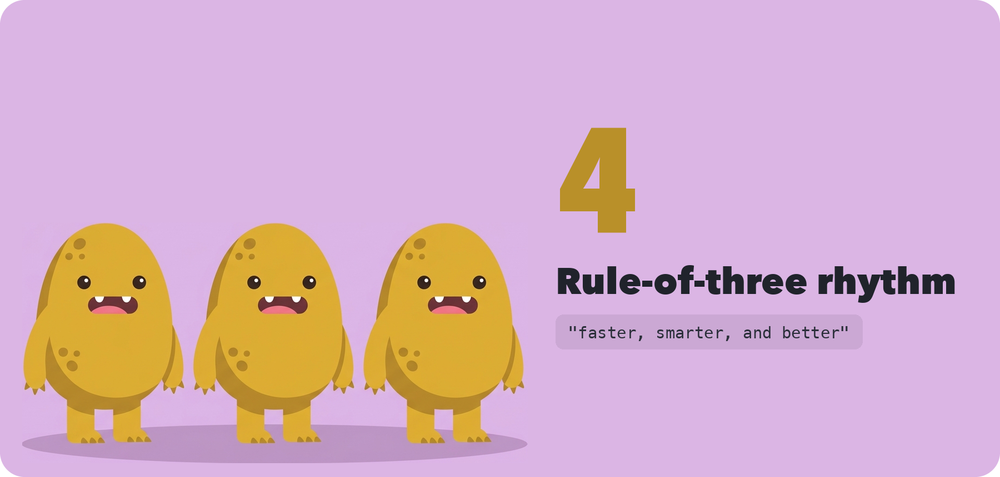

# SlopMonster

<div align="center">
  
  <p><strong>Arckhé AI</strong></p>
</div>


**🇧🇷 [Português](README.md) · 🇺🇸 [English](README.en.md) · 🇪🇸 [Español](README.es.md)**


**Transforme texto escrito por IA em texto que uma pessoa publicaria.**

## 📖 Guia de uso

Guia completo (landing + passo a passo): **https://inematds.github.io/SlopMonster/guia/**

Texto de IA tem cheiro. `delve`, `seamless`, `unlock`, `it's not just a tool, it's a
journey`. O leitor já percebe, e uma página com esse cheiro é uma página em que ele
para de confiar.

A maioria das ferramentas que corrige isso nasce da mesma pesquisa pública. Esta
acrescenta as duas coisas que as outras pulam.

**Ela dá uma nota de 0 a 5 ao seu texto e pode derrubar o seu build.** Sem opinião, sem
achismo, só padrões. Desenvolvedor chama isso de linter. Todo mundo pode chamar de um
verificador que não deixa você publicar.

**Um modelo rival faz a limpeza.** Se o Claude escreveu o rascunho, o GPT limpa. Um modelo
não escuta o próprio sotaque, do mesmo jeito que você não escuta o seu.

Funciona em landing pages, READMEs, e-mails e roteiros. Qualquer coisa que uma pessoa vai
ler e julgar.

## O ciclo

```
1. PONTUAR   tools/deslop.py     dá nota de 0 a 5, sai em vermelho abaixo de 5. Padrões, sem opinião.
2. REESCREVER três passadas       mata o vocabulário → mata as formas → coloca uma pessoa de volta
3. LIMPAR    tools/cleanse.sh    uma família de modelo diferente tira as marcas que a primeira deixou
4. REPONTUAR tools/deslop.py     só publica em 5/5
```

O pontuador tem a primeira e a última palavra, porque o pontuador é honesto e o modelo é
persuasivo. "Quase limpo" é como uma página acaba soando igual a todas as outras páginas
de IA da internet.

## Recibos, não promessas

Uma rodada real em sete frases literais da home do Jasper.ai (29 ago 2026):

| | nota |
|---|---|
| O texto deles, como foi baixado | **3/5**, com `unlock`, `empower` e quatro listas de três |
| Depois de uma passada por este ciclo | **5/5**, sentido intacto, tamanho dentro de 10%, nada inventado |

Cada comando e sua saída exata: [`examples/jasper-live-run.md`](examples/jasper-live-run.md).
O texto deles é citado para fins de crítica e continua sendo deles. A licença MIT abaixo
cobre o código e a prosa deste repositório.

## Início rápido

```bash
git clone https://github.com/inematds/SlopMonster && cd SlopMonster

# pontuar qualquer coisa
python3 tools/deslop.py --text "It's not just a tool, it's a game-changing journey."
# → score 3/5, aponta as duas marcas, sai com código 1

# pontuar uma página pronta (lê só o que o visitante ENXERGA)
python3 tools/deslop.py index.html

# pontuar um arquivo markdown (pula trechos de código, blocos cercados e texto riscado)
python3 tools/deslop.py README.md

# limpar um rascunho com um modelo rival e repontuar
tools/cleanse.sh rascunho.md > limpo.md
python3 tools/deslop.py --text "$(cat limpo.md)"

# seus números são reais e você consegue provar? impede a regra de prova de travar o build
python3 tools/deslop.py index.html --allow-proof

# mexeu numa regex? isto é o que pega um catálogo que ficou meio cego em silêncio
python3 tools/test_deslop.py
```

**O catálogo é só em inglês.** Texto em outra língua, inclusive português, recebe 5/5
porque o pontuador não consegue ler, não porque está limpo. O passo de limpeza com modelo
rival funciona em qualquer língua, mas a nota só vale para texto em inglês.

Sem dependências. O pontuador é Python puro, biblioteca padrão. O script de limpeza precisa
de uma CLI de IA (`codex` ou `claude`), ou de nenhuma, e nesse caso ele imprime o prompt
para você colar. O arquivo `.github/workflows/slop.yml` é o portão de build, pronto para
copiar no seu próprio repositório.

### Instalar como skill de agente

**Claude Code:** copie esta pasta para `~/.claude/skills/slopmonster/` e diga `/slopmonster`,
"tira o slop disso" ou "de-slop this". **Codex e outros agentes:** aponte o agente para o
`SKILL.md`. São instruções em markdown puro, nada específico do Claude.

## A limpeza sabe qual modelo escreveu

A regra: a limpeza roda numa **família de modelo diferente** da que escreveu o rascunho.
Famílias diferentes têm sotaques diferentes, e um modelo é ruim em ouvir o próprio.

| Você trabalha em | Sotaque do rascunho | O `cleanse.sh` faz |
|---|---|---|
| Claude Code | Anthropic | chama o **GPT-5.6** pela sua CLI `codex`, com tempo limite e sandbox só leitura |
| Codex / ChatGPT | OpenAI | com `DESLOP_WRITER=gpt` ele chama o **Claude** via `claude -p` |
| Gemini CLI | Google | a CLI rival que estiver instalada |
| nenhuma CLI rival | n/a | imprime o prompt completo para colar no chat da outra família |

Ele se recusa a mandar um rascunho de volta para a própria família. Modelo corrigindo a
própria prova é exatamente o que este passo existe para evitar.

Depois ele repontua, sempre: um modelo de ponta é muito bom em tirar marcas e bem capaz de
colocar outras novas enquanto faz isso.

## O que o pontuador caça

Cinco grupos. Cai em um e perde um ponto. Abaixo de 5/5 o comando sai em vermelho, então
um build pode parar nele.

Quatro grupos tiram o sotaque de IA. O quinto pergunta se a linha vende alguma coisa.

Cada antes e depois abaixo é uma linha real do site da Ridgeline Roofing. Riscado é o que
o primeiro rascunho dizia. Negrito é o que foi publicado. O registro completo:
[`examples/ridgeline-roofing.md`](examples/ridgeline-roofing.md).

Cada exemplo nesta página está em `formato de código` ou riscado. Isso não é decoração. Um
literal não é texto de venda, então o `deslop.py` pula os dois quando lê um arquivo `.md`.


**1. Vocabulário de IA.** Palavras que aparecem muito mais em texto de IA do que em texto
humano.

São duas listas, e elas funcionam de jeitos diferentes.

A primeira lista casa pela raiz. Então `elevate` também pega `elevates`, `elevated` e
`elevating`. Isso importa mais do que parece. Página de vendas é escrita na terceira pessoa.
`Acme elevates your workflow` é a forma mais comum da palavra, e a busca exata passava
direto por ela.

A segunda lista tem palavras que também têm um sentido honesto no dia a dia. `crafted`,
`harness`, `landscape`, `journey`. Essas são casadas palavra por palavra. Assim "we craft
furniture by hand" continua limpo, e só o uso de marketing é pego.

A correção é uma palavra mais simples. Não um sinônimo mais chique para a mesma ideia.

> ~~We leverage industry-leading materials to deliver unparalleled protection.~~
> **We source materials from manufacturers who test for wind, hail and sun.**
> `leverage`, `deliver`, `unparalleled`. Nenhuma delas diz nada, e cada uma custa uma linha.


**2. Construções de IA.** Este grupo pega formas de frase, não palavras isoladas.

Uma forma é um molde que você preenche com qualquer coisa. `not just X, but Y` é o mais
barulhento do inglês hoje. Depois que você vê, não consegue mais deixar de ver.

Há 17 formas na lista. Coisas como `that's where X comes in`, `say goodbye to` e
`whether you're X or Y`, pilhas de ressalva como `could potentially`, e perguntas que o
autor responde sozinho.

As formas curta e longa são checadas, "it's" e "it is". Registro formal não é disfarce
esperto. É o padrão do que um modelo escreve.

Formas valem mais que palavras, porque uma página pode passar num teste de vocabulário e
ainda parecer escrita por máquina.

> ~~Not just a roof, but peace of mind.~~
> **A written scope and a fixed number before anyone climbs a ladder.**
> A forma promete uma revelação e entrega uma abstração.


**3. Cadência de pontuação.** Dois travessões dentro de uma mesma frase.

Um travessão num parágrafo é pontuação. Três é tique. Modelos usam travessão numa taxa de
três a cinco vezes a de um humano.

A checagem só olha dentro de uma janela de 220 caracteres, e esse limite faz trabalho de
verdade. Texto de interface não tem ponto final. Itens de menu, botões e rótulos se
emendam, então uma quebra de frase ingênua trata a página inteira como uma frase só e a
regra dispara em tudo. Um pontuador que grita lobo é desligado, então a janela fica.

Ponto e vírgula também conta, mas só acima de um piso de três, proporcional ao tamanho da
página. Dois pontos e vírgula num documento técnico longo é estilo, não marca.

> ~~Our team — trained, certified and local — is ready to help.~~
> **Thirty-eight on the crew, factory-trained for every material we install.**
> Os travessões escondiam que a frase não tinha informação nenhuma.



**4. Ritmo de três.** Três itens em sequência. `faster, smarter, and better`.

Três adjetivos é ritmo, não argumento. Um tricolon é retórica. Três deles numa página é
máquina. Tricolon é só o nome chique de uma lista de três itens.

Esta checagem é estreita de propósito, e só duas formas a disparam. Com a vírgula de Oxford,
precisa de três palavras soltas. Sem ela, o terceiro item tem que ser uma frase curta que
fecha a oração.

A estreiteza é o ponto. "Inspection, repair and replacement for homes and commercial
buildings" são três coisas reais que um telhadista faz, e passa limpo. Marcar isso seria
gritar lobo, e a próxima pessoa desligaria o pontuador.

> ~~Trusted, reliable and built to last.~~
> **Six nails per shingle, every shingle.**
> Uma especificação ganha de três adjetivos toda vez. Ninguém inventa uma linha dessas,
> porque texto inventado não sabe disso.


**5. Vendas e marketing.** As quatro primeiras regras tiram o robô. Esta faz a pergunta
mais difícil. A linha vende alguma coisa?

Texto limpo que não diz nada continua sendo página morta. Duas coisas rodam aqui.

**A regra dura: nunca inventar prova.** Nada de contagem de clientes, depoimentos ou
avaliações que o negócio não conquistou. O pontuador marca qualquer número ao lado de um
substantivo de gente, como `10,000+ happy users`. Ele dispara fácil de propósito. Um alarme
falso custa dez segundos. Um erro deixa no seu site uma afirmação que você não sustenta. Se
o número é real e você consegue provar, `--allow-proof` rebaixa para aviso e ainda imprime
os acertos.

Prova falsa é uma falha de vendas antes de ser uma falha de escrita. Ninguém compra de uma
página que pegou mentindo.

> ~~Loved by 10,000+ happy homeowners.~~
> **Project names and photography are placeholders. Swap in your own jobs before this goes live.**
> Diga que o espaço está vazio. Soa como confiança, não como fraqueza.

> ~~The area's most trusted roofing experts.~~
> **Roofing, and only roofing, since 2001.**
> "Mais confiável" não dá para checar, então o leitor desconta. Uma data não tem como discutir.

**De onde as linhas vêm.** Quatro fontes. Se uma frase não consegue dizer sua fonte, ela
não entra na página.

1. **O que o ofício faz de verdade.** A fonte mais forte, de longe. "Seis pregos por telha"
   é uma especificação real com um modo de falha real por trás.
2. **O que o cliente já teme.** Que o preço vai mudar. Que o quintal vai ficar destruído.
   Que estão vendendo um telhado inteiro para um problema de rufo.
3. **O que a concorrência não vai dizer.** Recusa viaja mais longe que promessa. "Não fazemos
   sobreposição" posiciona você e desqualifica o cliente errado numa linha só.
4. **As linhas que já eram boas.** "From first call to final nail" chegou escrita no
   wireframe e ganhou de toda reescrita. Ficou.

**O trabalho nomeado por trás da reescrita:**

| Quem | O que isso pede |
|---|---|
| **Steve Krug**, *Don't Make Me Think* (2000) | cada linha que o leitor precisa decifrar é uma linha que ele pula |
| **Daniel Priestley**, ordem do pitch | abre no problema e no insight, nunca no produto |
| **Alex Hormozi**, o lado da oferta | dor nomeada, especificidade checável, prova que você tem de fato |

Esses três mais o benchmark da categoria viram cinco princípios de trabalho, cada um com um
antes e depois real: [`references/principles.md`](references/principles.md).

## O que entra no lugar das marcas

Limpo não é o mesmo que bom. Cinco princípios decidem o que a linha diz no lugar: o
*Don't Make Me Think* do Krug, a ordem de pitch do Priestley que abre no problema, e o
argumento do Hormozi, pelo lado da oferta, de que especificidade vence superlativo. Cada
um com um antes e depois real: [`references/principles.md`](references/principles.md).

## Um exemplo completo

O site da Ridgeline Roofing: de um wireframe em Lorem ipsum a um site publicado, com o
antes → depois de cada título, as seis marcas pegas nos primeiros rascunhos e a passada de
verificar-ou-marcar em cada número. Este é o arquivo que ensina:
[`examples/ridgeline-roofing.md`](examples/ridgeline-roofing.md).

> ~~The area's most trusted roofing experts.~~
> **Roofing, and only roofing, since 2001.**
> "Mais confiável" não é falseável, então o leitor desconta inteiro. Uma data não tem como discutir.

## A única regra dura

**Nunca inventar prova.** Nada de contagem de usuários, depoimentos ou avaliações que você
não conquistou. Se uma afirmação precisa de um número que você não tem, escreva
`[needs number]` e siga em frente. O ganho de um número inventado é menor que o ganho de
uma especificidade real, e é o único erro sem volta.

E esta skill nunca vai prometer "enganar detectores de IA". Detector é ruído. O alvo é o
instinto de um leitor humano.

Sobre este arquivo: `python3 tools/deslop.py README.md` dá **5/5**, mas com uma ressalva
honesta. Os exemplos em inglês estão marcados como literais, em `código` ou riscados, e o
pontuador pula os dois. A prosa em volta está em português, e o catálogo não lê português.
A versão original em inglês deste README passava no próprio pontuador sem nada suavizado.

## Em que isto se apoia

Todas as fontes estão em [`references/sources.md`](references/sources.md):
o *Signs of AI writing* da Wikipedia (WikiProject AI Cleanup) como catálogo canônico,
mais quatro humanizadores open source sob MIT: `blader/humanizer`,
`harshaneel/humanize`, `lguz/humanize-writing-skill`, `haidrrrry/humanize-ai-writing`.
Os princípios de reescrita vêm de Krug, Priestley e Hormozi. Repositórios de burlar
detector ficam de fora de propósito.

## Mapa do repositório

```
SKILL.md                            a skill de agente, o ciclo inteiro como instruções
tools/deslop.py                     o pontuador. biblioteca padrão, sem deps, sai em vermelho abaixo de 5/5
tools/test_deslop.py                suíte de regressão. rode depois de mexer em qualquer regex
tools/cleanse.sh                    limpeza com modelo rival, roteada sozinha, com tempo limite
.github/workflows/slop.yml          o portão de build, pronto para copiar
prompts/cleanse.txt                 a instrução exata que o modelo de limpeza recebe
references/signs-of-ai-writing.md   o catálogo completo: 2 níveis de vocabulário, 8 formas, cadência, ritmo, prova
references/principles.md            os cinco princípios de reescrita, cada um com um par real
references/sources.md               cada fonte em que isto se apoia
examples/ridgeline-roofing.md       site completo, cada linha antes → depois
examples/jasper-live-run.md         rodada real sem edição: 3/5 → 5/5 numa página de verdade
```

MIT. A mesma dos humanizadores em que se apoia.

---

<div align="center">
  
  <p><strong>Arckhé AI</strong></p>
</div>