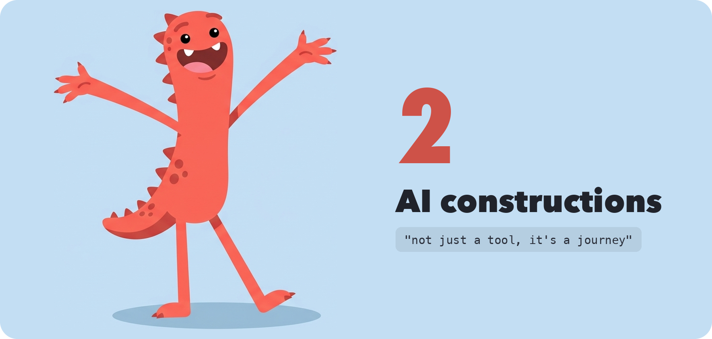
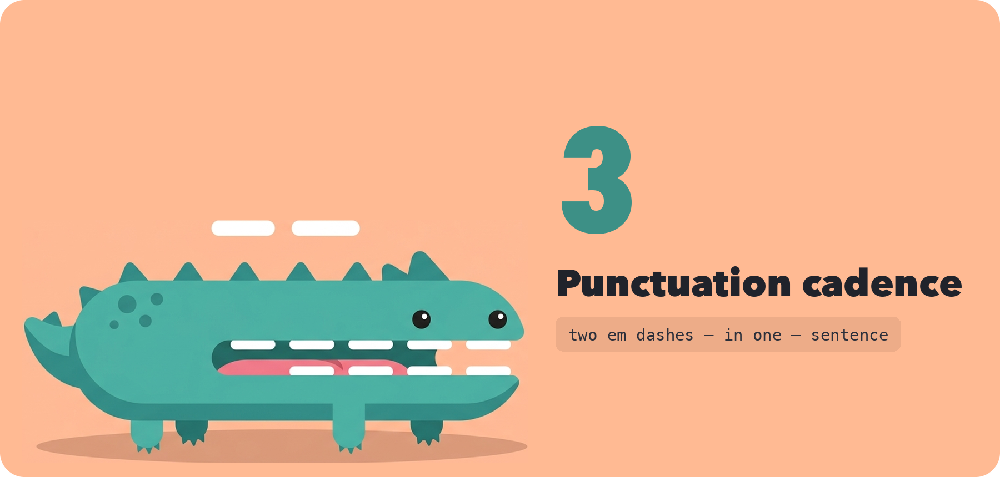

# SlopMonster

<div align="center">
  
  <p><strong>Arckhé AI</strong></p>
</div>


**ê°Å¸â€¡Â§ê°Å¸â€¡Â· [PortuguêƒÂªs](README.md) ê‚· ê°Å¸â€¡Âºê°Å¸â€¡Â¸ [English](README.en.md) ê‚· ê°Å¸â€¡Âªê°Å¸â€¡Â¸ [EspaêƒÂ±ol](README.es.md)**


**Transforme texto escrito por IA em texto que uma pessoa publicaria.**

## ê°Å¸â€œâ€“ Guia de uso

Guia completo (landing + passo a passo): **https://inematds.github.io/SlopMonster/guia/**

Texto de IA tem cheiro. `delve`, `seamless`, `unlock`, `it's not just a tool, it's a
journey`. O leitor jêƒÂ¡ percebe, e uma pêƒÂ¡gina com esse cheiro êƒÂ© uma pêƒÂ¡gina em que ele
para de confiar.

A maioria das ferramentas que corrige isso nasce da mesma pesquisa pêƒÂºblica. Esta
acrescenta as duas coisas que as outras pulam.

**Ela dêƒÂ¡ uma nota de 0 a 5 ao seu texto e pode derrubar o seu build.** Sem opiniêƒÂ£o, sem
achismo, sêƒÂ³ padrêƒÂµes. Desenvolvedor chama isso de linter. Todo mundo pode chamar de um
verificador que nêƒÂ£o deixa vocêƒÂª publicar.

**Um modelo rival faz a limpeza.** Se o Claude escreveu o rascunho, o GPT limpa. Um modelo
nêƒÂ£o escuta o prêƒÂ³prio sotaque, do mesmo jeito que vocêƒÂª nêƒÂ£o escuta o seu.

Funciona em landing pages, READMEs, e-mails e roteiros. Qualquer coisa que uma pessoa vai
ler e julgar.

## O ciclo

```
1. PONTUAR   tools/deslop.py     dêƒÂ¡ nota de 0 a 5, sai em vermelho abaixo de 5. PadrêƒÂµes, sem opiniêƒÂ£o.
2. REESCREVER trêƒÂªs passadas       mata o vocabulêƒÂ¡rio ê¢â€ â€™ mata as formas ê¢â€ â€™ coloca uma pessoa de volta
3. LIMPAR    tools/cleanse.sh    uma famêƒÂ­lia de modelo diferente tira as marcas que a primeira deixou
4. REPONTUAR tools/deslop.py     sêƒÂ³ publica em 5/5
```

O pontuador tem a primeira e a êƒÂºltima palavra, porque o pontuador êƒÂ© honesto e o modelo êƒÂ©
persuasivo. "Quase limpo" êƒÂ© como uma pêƒÂ¡gina acaba soando igual a todas as outras pêƒÂ¡ginas
de IA da internet.

## Recibos, nêƒÂ£o promessas

Uma rodada real em sete frases literais da home do Jasper.ai (29 ago 2026):

| | nota |
|---|---|
| O texto deles, como foi baixado | **3/5**, com `unlock`, `empower` e quatro listas de trêƒÂªs |
| Depois de uma passada por este ciclo | **5/5**, sentido intacto, tamanho dentro de 10%, nada inventado |

Cada comando e sua saêƒÂ­da exata: [`examples/jasper-live-run.md`](examples/jasper-live-run.md).
O texto deles êƒÂ© citado para fins de crêƒÂ­tica e continua sendo deles. A licenêƒÂ§a MIT abaixo
cobre o cêƒÂ³digo e a prosa deste repositêƒÂ³rio.

## InêƒÂ­cio rêƒÂ¡pido

```bash
git clone https://github.com/inematds/SlopMonster && cd SlopMonster

# pontuar qualquer coisa
python3 tools/deslop.py --text "It's not just a tool, it's a game-changing journey."
# ê¢â€ â€™ score 3/5, aponta as duas marcas, sai com cêƒÂ³digo 1

# pontuar uma pêƒÂ¡gina pronta (lêƒÂª sêƒÂ³ o que o visitante ENXERGA)
python3 tools/deslop.py index.html

# pontuar um arquivo markdown (pula trechos de cêƒÂ³digo, blocos cercados e texto riscado)
python3 tools/deslop.py README.md

# limpar um rascunho com um modelo rival e repontuar
tools/cleanse.sh rascunho.md > limpo.md
python3 tools/deslop.py --text "$(cat limpo.md)"

# seus nêƒÂºmeros sêƒÂ£o reais e vocêƒÂª consegue provar? impede a regra de prova de travar o build
python3 tools/deslop.py index.html --allow-proof

# mexeu numa regex? isto êƒÂ© o que pega um catêƒÂ¡logo que ficou meio cego em silêƒÂªncio
python3 tools/test_deslop.py
```

**O catêƒÂ¡logo êƒÂ© sêƒÂ³ em inglêƒÂªs.** Texto em outra lêƒÂ­ngua, inclusive portuguêƒÂªs, recebe 5/5
porque o pontuador nêƒÂ£o consegue ler, nêƒÂ£o porque estêƒÂ¡ limpo. O passo de limpeza com modelo
rival funciona em qualquer lêƒÂ­ngua, mas a nota sêƒÂ³ vale para texto em inglêƒÂªs.

Sem dependêƒÂªncias. O pontuador êƒÂ© Python puro, biblioteca padrêƒÂ£o. O script de limpeza precisa
de uma CLI de IA (`codex` ou `claude`), ou de nenhuma, e nesse caso ele imprime o prompt
para vocêƒÂª colar. O arquivo `.github/workflows/slop.yml` êƒÂ© o portêƒÂ£o de build, pronto para
copiar no seu prêƒÂ³prio repositêƒÂ³rio.

### Instalar como skill de agente

**Claude Code:** copie esta pasta para `~/.claude/skills/slopmonster/` e diga `/slopmonster`,
"tira o slop disso" ou "de-slop this". **Codex e outros agentes:** aponte o agente para o
`SKILL.md`. SêƒÂ£o instruêƒÂ§êƒÂµes em markdown puro, nada especêƒÂ­fico do Claude.

## A limpeza sabe qual modelo escreveu

A regra: a limpeza roda numa **famêƒÂ­lia de modelo diferente** da que escreveu o rascunho.
FamêƒÂ­lias diferentes têƒÂªm sotaques diferentes, e um modelo êƒÂ© ruim em ouvir o prêƒÂ³prio.

| VocêƒÂª trabalha em | Sotaque do rascunho | O `cleanse.sh` faz |
|---|---|---|
| Claude Code | Anthropic | chama o **GPT-5.6** pela sua CLI `codex`, com tempo limite e sandbox sêƒÂ³ leitura |
| Codex / ChatGPT | OpenAI | com `DESLOP_WRITER=gpt` ele chama o **Claude** via `claude -p` |
| Gemini CLI | Google | a CLI rival que estiver instalada |
| nenhuma CLI rival | n/a | imprime o prompt completo para colar no chat da outra famêƒÂ­lia |

Ele se recusa a mandar um rascunho de volta para a prêƒÂ³pria famêƒÂ­lia. Modelo corrigindo a
prêƒÂ³pria prova êƒÂ© exatamente o que este passo existe para evitar.

Depois ele repontua, sempre: um modelo de ponta êƒÂ© muito bom em tirar marcas e bem capaz de
colocar outras novas enquanto faz isso.

## O que o pontuador caêƒÂ§a

Cinco grupos. Cai em um e perde um ponto. Abaixo de 5/5 o comando sai em vermelho, entêƒÂ£o
um build pode parar nele.

Quatro grupos tiram o sotaque de IA. O quinto pergunta se a linha vende alguma coisa.

Cada antes e depois abaixo êƒÂ© uma linha real do site da Ridgeline Roofing. Riscado êƒÂ© o que
o primeiro rascunho dizia. Negrito êƒÂ© o que foi publicado. O registro completo:
[`examples/ridgeline-roofing.md`](examples/ridgeline-roofing.md).

Cada exemplo nesta pêƒÂ¡gina estêƒÂ¡ em `formato de cêƒÂ³digo` ou riscado. Isso nêƒÂ£o êƒÂ© decoraêƒÂ§êƒÂ£o. Um
literal nêƒÂ£o êƒÂ© texto de venda, entêƒÂ£o o `deslop.py` pula os dois quando lêƒÂª um arquivo `.md`.


**1. VocabulêƒÂ¡rio de IA.** Palavras que aparecem muito mais em texto de IA do que em texto
humano.

SêƒÂ£o duas listas, e elas funcionam de jeitos diferentes.

A primeira lista casa pela raiz. EntêƒÂ£o `elevate` tambêƒÂ©m pega `elevates`, `elevated` e
`elevating`. Isso importa mais do que parece. PêƒÂ¡gina de vendas êƒÂ© escrita na terceira pessoa.
`Acme elevates your workflow` êƒÂ© a forma mais comum da palavra, e a busca exata passava
direto por ela.

A segunda lista tem palavras que tambêƒÂ©m têƒÂªm um sentido honesto no dia a dia. `crafted`,
`harness`, `landscape`, `journey`. Essas sêƒÂ£o casadas palavra por palavra. Assim "we craft
furniture by hand" continua limpo, e sêƒÂ³ o uso de marketing êƒÂ© pego.

A correêƒÂ§êƒÂ£o êƒÂ© uma palavra mais simples. NêƒÂ£o um sinêƒÂ´nimo mais chique para a mesma ideia.

> ~~We leverage industry-leading materials to deliver unparalleled protection.~~
> **We source materials from manufacturers who test for wind, hail and sun.**
> `leverage`, `deliver`, `unparalleled`. Nenhuma delas diz nada, e cada uma custa uma linha.



**2. ConstruêƒÂ§êƒÂµes de IA.** Este grupo pega formas de frase, nêƒÂ£o palavras isoladas.

Uma forma êƒÂ© um molde que vocêƒÂª preenche com qualquer coisa. `not just X, but Y` êƒÂ© o mais
barulhento do inglêƒÂªs hoje. Depois que vocêƒÂª vêƒÂª, nêƒÂ£o consegue mais deixar de ver.

HêƒÂ¡ 17 formas na lista. Coisas como `that's where X comes in`, `say goodbye to` e
`whether you're X or Y`, pilhas de ressalva como `could potentially`, e perguntas que o
autor responde sozinho.

As formas curta e longa sêƒÂ£o checadas, "it's" e "it is". Registro formal nêƒÂ£o êƒÂ© disfarce
esperto. êƒâ€° o padrêƒÂ£o do que um modelo escreve.

Formas valem mais que palavras, porque uma pêƒÂ¡gina pode passar num teste de vocabulêƒÂ¡rio e
ainda parecer escrita por mêƒÂ¡quina.

> ~~Not just a roof, but peace of mind.~~
> **A written scope and a fixed number before anyone climbs a ladder.**
> A forma promete uma revelaêƒÂ§êƒÂ£o e entrega uma abstraêƒÂ§êƒÂ£o.



**3. CadêƒÂªncia de pontuaêƒÂ§êƒÂ£o.** Dois travessêƒÂµes dentro de uma mesma frase.

Um travessêƒÂ£o num parêƒÂ¡grafo êƒÂ© pontuaêƒÂ§êƒÂ£o. TrêƒÂªs êƒÂ© tique. Modelos usam travessêƒÂ£o numa taxa de
trêƒÂªs a cinco vezes a de um humano.

A checagem sêƒÂ³ olha dentro de uma janela de 220 caracteres, e esse limite faz trabalho de
verdade. Texto de interface nêƒÂ£o tem ponto final. Itens de menu, botêƒÂµes e rêƒÂ³tulos se
emendam, entêƒÂ£o uma quebra de frase ingêƒÂªnua trata a pêƒÂ¡gina inteira como uma frase sêƒÂ³ e a
regra dispara em tudo. Um pontuador que grita lobo êƒÂ© desligado, entêƒÂ£o a janela fica.

Ponto e vêƒÂ­rgula tambêƒÂ©m conta, mas sêƒÂ³ acima de um piso de trêƒÂªs, proporcional ao tamanho da
pêƒÂ¡gina. Dois pontos e vêƒÂ­rgula num documento têƒÂ©cnico longo êƒÂ© estilo, nêƒÂ£o marca.

> ~~Our team ê¢â‚¬â€ trained, certified and local ê¢â‚¬â€ is ready to help.~~
> **Thirty-eight on the crew, factory-trained for every material we install.**
> Os travessêƒÂµes escondiam que a frase nêƒÂ£o tinha informaêƒÂ§êƒÂ£o nenhuma.


**4. Ritmo de trêƒÂªs.** TrêƒÂªs itens em sequêƒÂªncia. `faster, smarter, and better`.

TrêƒÂªs adjetivos êƒÂ© ritmo, nêƒÂ£o argumento. Um tricolon êƒÂ© retêƒÂ³rica. TrêƒÂªs deles numa pêƒÂ¡gina êƒÂ©
mêƒÂ¡quina. Tricolon êƒÂ© sêƒÂ³ o nome chique de uma lista de trêƒÂªs itens.

Esta checagem êƒÂ© estreita de propêƒÂ³sito, e sêƒÂ³ duas formas a disparam. Com a vêƒÂ­rgula de Oxford,
precisa de trêƒÂªs palavras soltas. Sem ela, o terceiro item tem que ser uma frase curta que
fecha a oraêƒÂ§êƒÂ£o.

A estreiteza êƒÂ© o ponto. "Inspection, repair and replacement for homes and commercial
buildings" sêƒÂ£o trêƒÂªs coisas reais que um telhadista faz, e passa limpo. Marcar isso seria
gritar lobo, e a prêƒÂ³xima pessoa desligaria o pontuador.

> ~~Trusted, reliable and built to last.~~
> **Six nails per shingle, every shingle.**
> Uma especificaêƒÂ§êƒÂ£o ganha de trêƒÂªs adjetivos toda vez. NinguêƒÂ©m inventa uma linha dessas,
> porque texto inventado nêƒÂ£o sabe disso.


**5. Vendas e marketing.** As quatro primeiras regras tiram o robêƒÂ´. Esta faz a pergunta
mais difêƒÂ­cil. A linha vende alguma coisa?

Texto limpo que nêƒÂ£o diz nada continua sendo pêƒÂ¡gina morta. Duas coisas rodam aqui.

**A regra dura: nunca inventar prova.** Nada de contagem de clientes, depoimentos ou
avaliaêƒÂ§êƒÂµes que o negêƒÂ³cio nêƒÂ£o conquistou. O pontuador marca qualquer nêƒÂºmero ao lado de um
substantivo de gente, como `10,000+ happy users`. Ele dispara fêƒÂ¡cil de propêƒÂ³sito. Um alarme
falso custa dez segundos. Um erro deixa no seu site uma afirmaêƒÂ§êƒÂ£o que vocêƒÂª nêƒÂ£o sustenta. Se
o nêƒÂºmero êƒÂ© real e vocêƒÂª consegue provar, `--allow-proof` rebaixa para aviso e ainda imprime
os acertos.

Prova falsa êƒÂ© uma falha de vendas antes de ser uma falha de escrita. NinguêƒÂ©m compra de uma
pêƒÂ¡gina que pegou mentindo.

> ~~Loved by 10,000+ happy homeowners.~~
> **Project names and photography are placeholders. Swap in your own jobs before this goes live.**
> Diga que o espaêƒÂ§o estêƒÂ¡ vazio. Soa como confianêƒÂ§a, nêƒÂ£o como fraqueza.

> ~~The area's most trusted roofing experts.~~
> **Roofing, and only roofing, since 2001.**
> "Mais confiêƒÂ¡vel" nêƒÂ£o dêƒÂ¡ para checar, entêƒÂ£o o leitor desconta. Uma data nêƒÂ£o tem como discutir.

**De onde as linhas vêƒÂªm.** Quatro fontes. Se uma frase nêƒÂ£o consegue dizer sua fonte, ela
nêƒÂ£o entra na pêƒÂ¡gina.

1. **O que o ofêƒÂ­cio faz de verdade.** A fonte mais forte, de longe. "Seis pregos por telha"
   êƒÂ© uma especificaêƒÂ§êƒÂ£o real com um modo de falha real por trêƒÂ¡s.
2. **O que o cliente jêƒÂ¡ teme.** Que o preêƒÂ§o vai mudar. Que o quintal vai ficar destruêƒÂ­do.
   Que estêƒÂ£o vendendo um telhado inteiro para um problema de rufo.
3. **O que a concorrêƒÂªncia nêƒÂ£o vai dizer.** Recusa viaja mais longe que promessa. "NêƒÂ£o fazemos
   sobreposiêƒÂ§êƒÂ£o" posiciona vocêƒÂª e desqualifica o cliente errado numa linha sêƒÂ³.
4. **As linhas que jêƒÂ¡ eram boas.** "From first call to final nail" chegou escrita no
   wireframe e ganhou de toda reescrita. Ficou.

**O trabalho nomeado por trêƒÂ¡s da reescrita:**

| Quem | O que isso pede |
|---|---|
| **Steve Krug**, *Don't Make Me Think* (2000) | cada linha que o leitor precisa decifrar êƒÂ© uma linha que ele pula |
| **Daniel Priestley**, ordem do pitch | abre no problema e no insight, nunca no produto |
| **Alex Hormozi**, o lado da oferta | dor nomeada, especificidade checêƒÂ¡vel, prova que vocêƒÂª tem de fato |

Esses trêƒÂªs mais o benchmark da categoria viram cinco princêƒÂ­pios de trabalho, cada um com um
antes e depois real: [`references/principles.md`](references/principles.md).

## O que entra no lugar das marcas

Limpo nêƒÂ£o êƒÂ© o mesmo que bom. Cinco princêƒÂ­pios decidem o que a linha diz no lugar: o
*Don't Make Me Think* do Krug, a ordem de pitch do Priestley que abre no problema, e o
argumento do Hormozi, pelo lado da oferta, de que especificidade vence superlativo. Cada
um com um antes e depois real: [`references/principles.md`](references/principles.md).

## Um exemplo completo

O site da Ridgeline Roofing: de um wireframe em Lorem ipsum a um site publicado, com o
antes ê¢â€ â€™ depois de cada têƒÂ­tulo, as seis marcas pegas nos primeiros rascunhos e a passada de
verificar-ou-marcar em cada nêƒÂºmero. Este êƒÂ© o arquivo que ensina:
[`examples/ridgeline-roofing.md`](examples/ridgeline-roofing.md).

> ~~The area's most trusted roofing experts.~~
> **Roofing, and only roofing, since 2001.**
> "Mais confiêƒÂ¡vel" nêƒÂ£o êƒÂ© falseêƒÂ¡vel, entêƒÂ£o o leitor desconta inteiro. Uma data nêƒÂ£o tem como discutir.

## A êƒÂºnica regra dura

**Nunca inventar prova.** Nada de contagem de usuêƒÂ¡rios, depoimentos ou avaliaêƒÂ§êƒÂµes que vocêƒÂª
nêƒÂ£o conquistou. Se uma afirmaêƒÂ§êƒÂ£o precisa de um nêƒÂºmero que vocêƒÂª nêƒÂ£o tem, escreva
`[needs number]` e siga em frente. O ganho de um nêƒÂºmero inventado êƒÂ© menor que o ganho de
uma especificidade real, e êƒÂ© o êƒÂºnico erro sem volta.

E esta skill nunca vai prometer "enganar detectores de IA". Detector êƒÂ© ruêƒÂ­do. O alvo êƒÂ© o
instinto de um leitor humano.

Sobre este arquivo: `python3 tools/deslop.py README.md` dêƒÂ¡ **5/5**, mas com uma ressalva
honesta. Os exemplos em inglêƒÂªs estêƒÂ£o marcados como literais, em `cêƒÂ³digo` ou riscados, e o
pontuador pula os dois. A prosa em volta estêƒÂ¡ em portuguêƒÂªs, e o catêƒÂ¡logo nêƒÂ£o lêƒÂª portuguêƒÂªs.
A versêƒÂ£o original em inglêƒÂªs deste README passava no prêƒÂ³prio pontuador sem nada suavizado.

## Em que isto se apoia

Todas as fontes estêƒÂ£o em [`references/sources.md`](references/sources.md):
o *Signs of AI writing* da Wikipedia (WikiProject AI Cleanup) como catêƒÂ¡logo canêƒÂ´nico,
mais quatro humanizadores open source sob MIT: `blader/humanizer`,
`harshaneel/humanize`, `lguz/humanize-writing-skill`, `haidrrrry/humanize-ai-writing`.
Os princêƒÂ­pios de reescrita vêƒÂªm de Krug, Priestley e Hormozi. RepositêƒÂ³rios de burlar
detector ficam de fora de propêƒÂ³sito.

## Mapa do repositêƒÂ³rio

```
SKILL.md                            a skill de agente, o ciclo inteiro como instruêƒÂ§êƒÂµes
tools/deslop.py                     o pontuador. biblioteca padrêƒÂ£o, sem deps, sai em vermelho abaixo de 5/5
tools/test_deslop.py                suêƒÂ­te de regressêƒÂ£o. rode depois de mexer em qualquer regex
tools/cleanse.sh                    limpeza com modelo rival, roteada sozinha, com tempo limite
.github/workflows/slop.yml          o portêƒÂ£o de build, pronto para copiar
prompts/cleanse.txt                 a instruêƒÂ§êƒÂ£o exata que o modelo de limpeza recebe
references/signs-of-ai-writing.md   o catêƒÂ¡logo completo: 2 nêƒÂ­veis de vocabulêƒÂ¡rio, 8 formas, cadêƒÂªncia, ritmo, prova
references/principles.md            os cinco princêƒÂ­pios de reescrita, cada um com um par real
references/sources.md               cada fonte em que isto se apoia
examples/ridgeline-roofing.md       site completo, cada linha antes ê¢â€ â€™ depois
examples/jasper-live-run.md         rodada real sem ediêƒÂ§êƒÂ£o: 3/5 ê¢â€ â€™ 5/5 numa pêƒÂ¡gina de verdade
```

MIT. A mesma dos humanizadores em que se apoia.

---

<div align="center">
  
  <p><strong>Arckhé AI</strong></p>
</div>